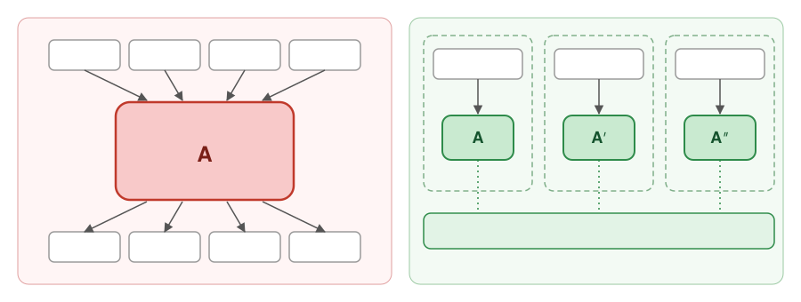
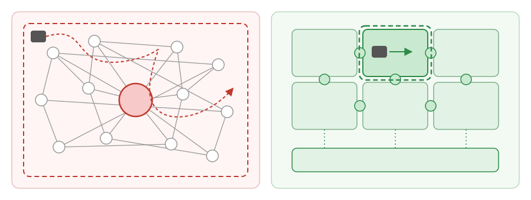
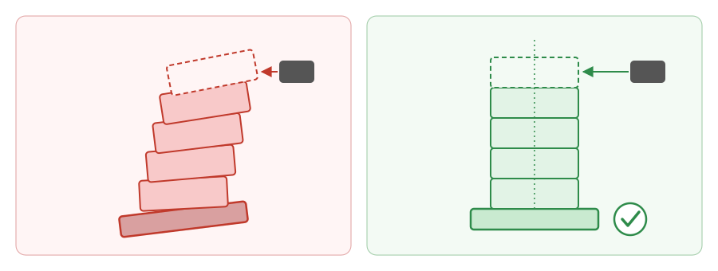

# The Software Printer Therapist's Notebook: Why Architecture Matters More When Code Is Cheap

*Software Engineering in the AI Era*
*[Nanw1103](https://github.com/nanw1103/software-printer-therapist-notebook), Nov. 11, 2026*

When code becomes cheap to print, engineering value shifts from typing the code to knowing what should exist, how it fits together, and whether the printer has quietly made a mess.

## Part I — The Economics of the Software Printer

*When code becomes cheap, what becomes expensive?*

> Duplicate implementations when it buys independence. Centralize invariants when consistency matters.

1. **Print the Code. Architect the Machine.** Code generation is becoming a commodity. The hard part is deciding what to build, how to organize it, and how the pieces fit together—not admiring the freshly printed lines.

2. **DRY, but Not at Any Cost.** Traditional deduplication saves manual coding effort. In the AI era, a little repeated code may be cheaper than a shared abstraction with a dozen flags, hidden dependencies, and a user manual.

3. **Printing Is Cheap; Changing the Plumbing Isn't.** Creation costs are falling, but integration, verification, maintenance, and unintended side effects remain expensive. Optimize for safe changes and replaceable pieces. When many components depend on one ever-growing fat component, the whole gets smaller, but that node gets larger and the dependencies tangle. A measured amount of duplication keeps large domains relatively self-contained, each component tiny and single-purpose, and the lines between nodes clear—better for architecture, printing, maintenance, and replacement.

## Part II — Architecture That Keeps the Printer Sane

*How to design software that AI can build without making a mess.*

> A component should be small enough to regenerate, clear enough to review, and independent enough to replace.

1. **Architecture Is a Jigsaw Puzzle, Not a Blob.** Clear interfaces and independent components let humans and AI work on one piece at a time without loading the entire system into their heads—or context windows.

2. **Don't Turn Every Component into a Swiss Army Knife.** Adding responsibilities to an existing component often buys more branches, ambiguity, and surprises. A small, well-bounded new component can be easier to generate, review, and maintain—especially when the legacy one never had a clear job description.

3. **Reuse the Recipe, Not Always the Leftovers.** Contracts, specifications, invariants, and tests are durable reusable assets. Independent components can follow the same recipe without sharing a tangled implementation.

4. **AI Prints Complexity at Industrial Speed, Too.** Vague responsibilities and branching logic give AI more room to wander off-spec. Explicit boundaries shrink the reasoning surface and help keep the printer on the rails.

## Part III — Confessions of a Software Printer Therapist

*The printer is confident. Someone still needs to understand the software.*

8. **The Printer Is Too Polite to Say Your Architecture Sucks.** Trained on mountains of ordinary code and tuned to be agreeable, AI often treats the existing mess as a style guide. It keeps “fitting in” with shaky abstractions and temporary hacks, stacking new floors on a crooked foundation. Without firm architectural principles and explicit boundaries, the printer doesn't fix the building—it helps it lean faster.

9. **Don't Let the Printer Do Your Thinking.** Most people use AI to skip understanding, not to automate work they already understand. Learn what success and failure look like first; then automate the tedious parts of work you love.

---

> **Print the code. Design the boundaries. Own the architecture. Never outsource your judgment.**
>
> The printer doesn't need to understand the architecture. You do.
