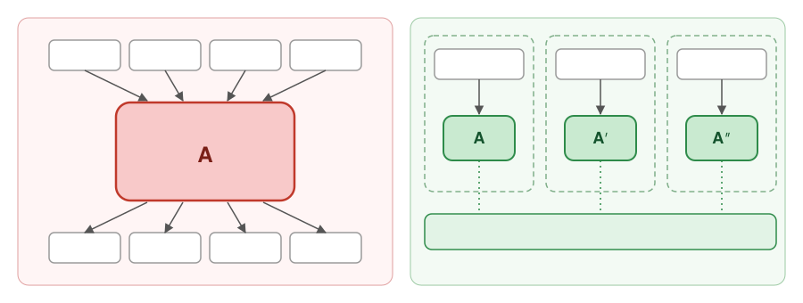
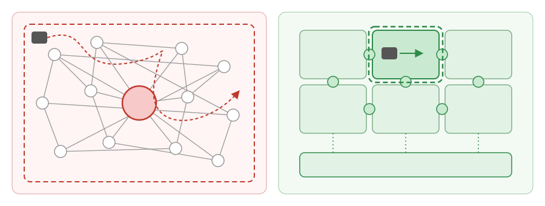
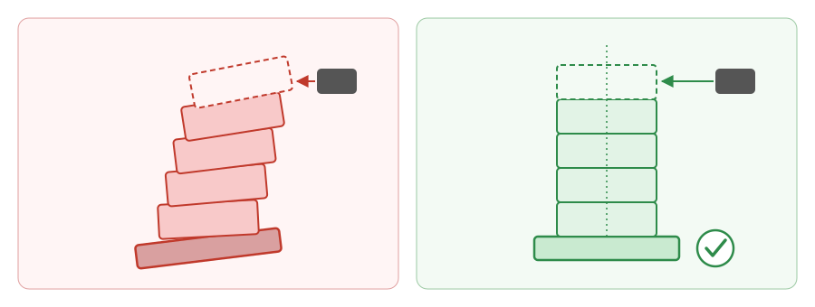

# 软件打印机治疗师笔记：代码变廉价之后，架构为何更重要

*AI 时代的软件工程*
*[Nanw1103](https://github.com/nanw1103/software-printer-therapist-notebook), Nov. 11, 2026*

当代码变得像打印一样廉价，工程的价值就从“敲代码”转向了解“应该存在什么、各部分如何组合，以及打印机是否悄悄把事情搞砸了”。

## 第一部分 — 软件打印机的经济学

*代码变廉价了，什么变昂贵了？*

1. **打印代码，设计机器。** 代码生成正在变成一种商品。真正困难的是决定构建什么、如何组织、各部分如何衔接——而不是欣赏刚打印出来的代码行。

2. **不重复自己，但需要有度。** 传统的去重，是让系统里的同一项职责由同一个模块负责。在 AI 时代，一小段重复代码比一个带着十几个开关、隐藏依赖和一本使用手册的共享抽象更便宜。

3. **打印很便宜，改管道却不便宜。** 创建的成本在下降，但集成、验证、维护以及意外的副作用依然昂贵。应优化的是安全的变更和可替换的组件。多个组件都依赖一个不断膨胀的胖组件，整体变小了，单节点却变大，依赖也缠在一起。适当重复，让大领域相对自包含、每个组件极小且职责单一、节点间依赖清晰，在架构、打印、维护和替换上都更有优势。

## 第二部分 — 让打印机保持理智的架构

*如何设计出 AI 能够构建、又不会搞乱的软件。*

4. **架构是一块拼图，而不是一团糊。** 清晰的接口和相互独立的组件，让人和 AI 可以一次只处理一块，而无需把整个系统都装进脑子里——或上下文窗口里。

5. **别把每个组件都变成瑞士军刀。** 给现有组件不断添加职责，往往只会换来更多分支、歧义和意外。一个小而边界清晰的新组件，可能更容易生成、评审和维护——尤其是当旧组件从来没有明确的职责说明时。

6. **复用配方，而不一定复用剩菜。** 契约、规格、不变量和测试是持久、可复用的资产。独立的组件可以遵循同一份配方，而无需共享纠缠在一起的实现。

7. **AI 也会以工业速度打印复杂性。** 模糊的职责和分支逻辑会给 AI 更多偏离规格的空间。明确的边界能缩小推理的范围，帮助打印机保持在正轨上。

## 第三部分 — 一名软件打印机治疗师的自白

*打印机很自信。但仍然需要有人去理解软件。*

8. **软件打印机治疗师的烦恼：AI 礼貌到不敢质疑地基。** AI 在海量普通代码上训练，又被调教得善解人意，因此常常把现有的烂摊子当成风格指南。它会持续“融入”摇摇欲坠的抽象和临时补丁，在歪斜的地基上继续加盖楼层。没有坚实的架构原则和明确的边界，打印机不但修不好这栋楼，反而会让它歪得更快。

9. **别让打印机替你思考。** 陷阱在于，要求 AI 取代理解，而不是自动化你本已理解的工作。先学会识别成功与失败；然后，再把你热爱的那些繁琐工程环节交给它自动完成。

---

> **打印代码，设计边界，掌控架构，永远不要外包你的判断力。**
>
> 打印机不需要理解架构。你需要。
